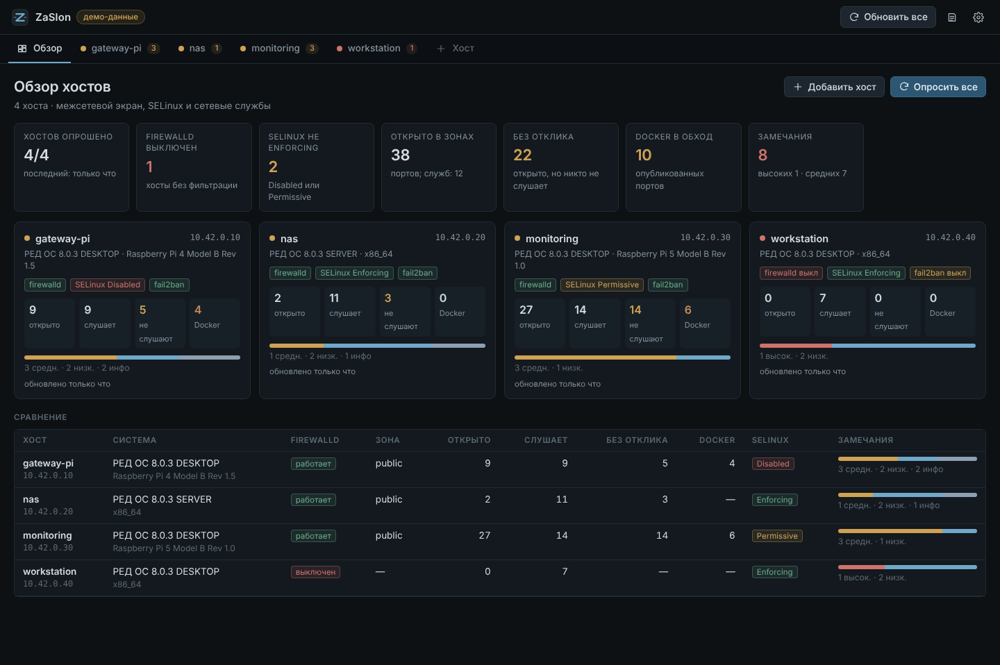
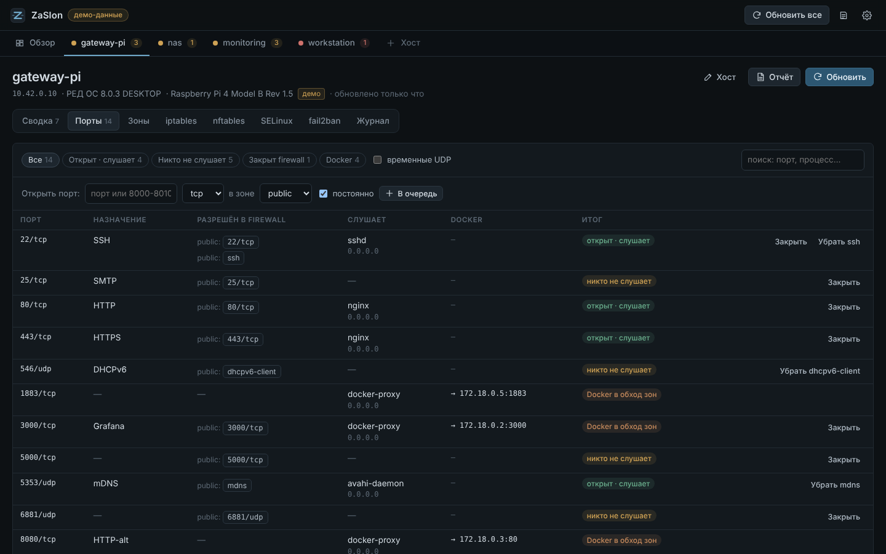
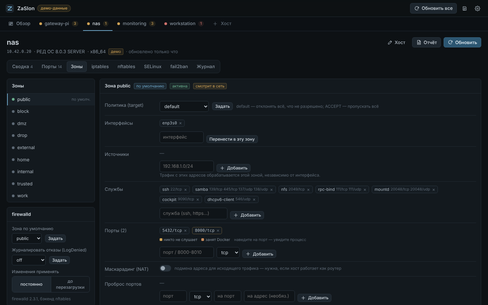
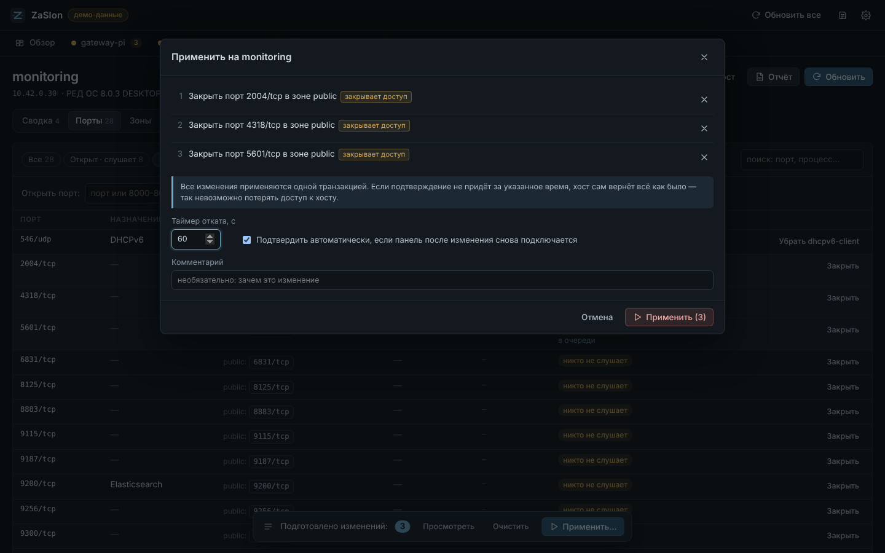
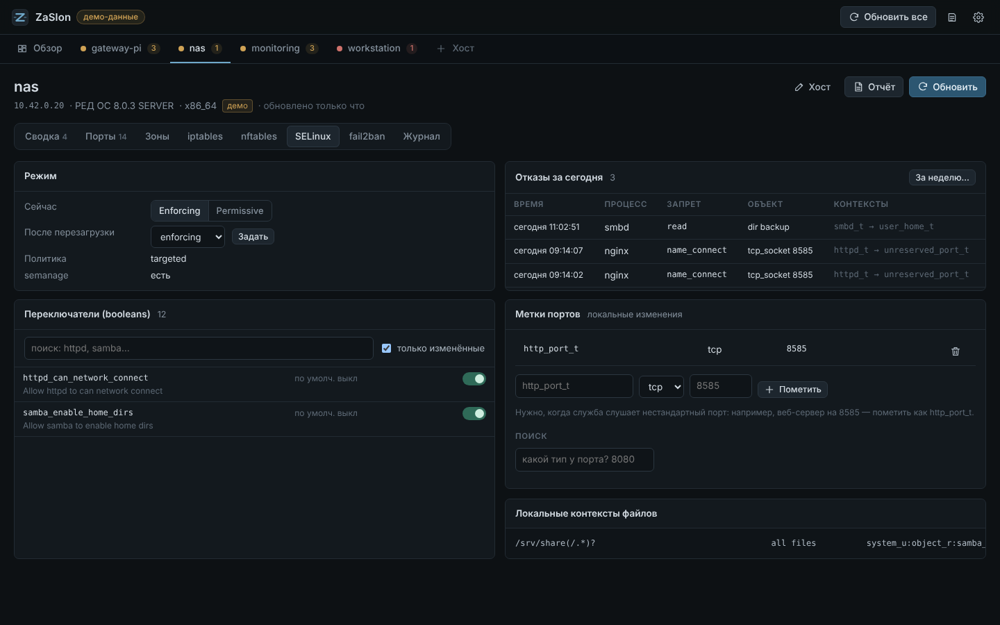
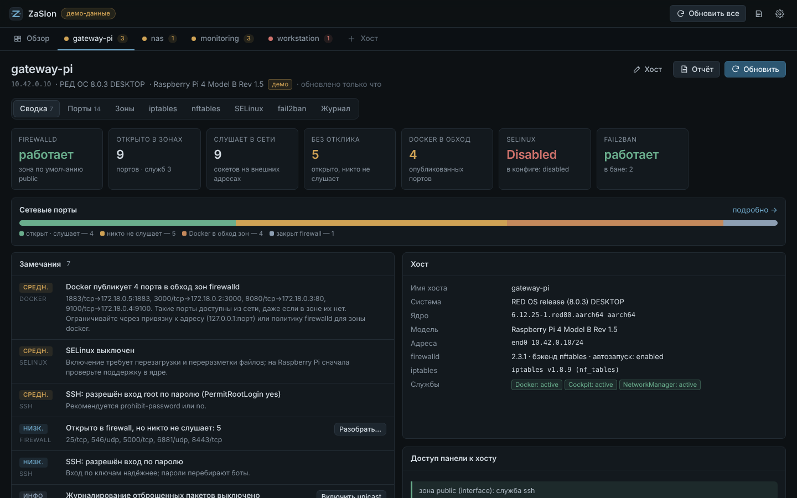
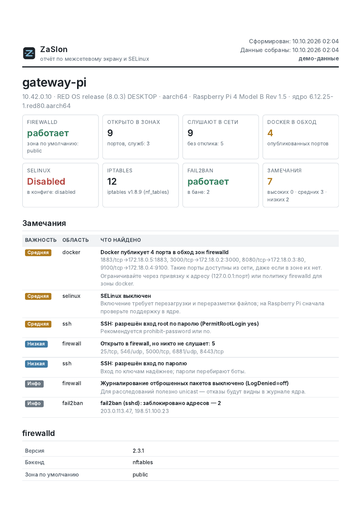
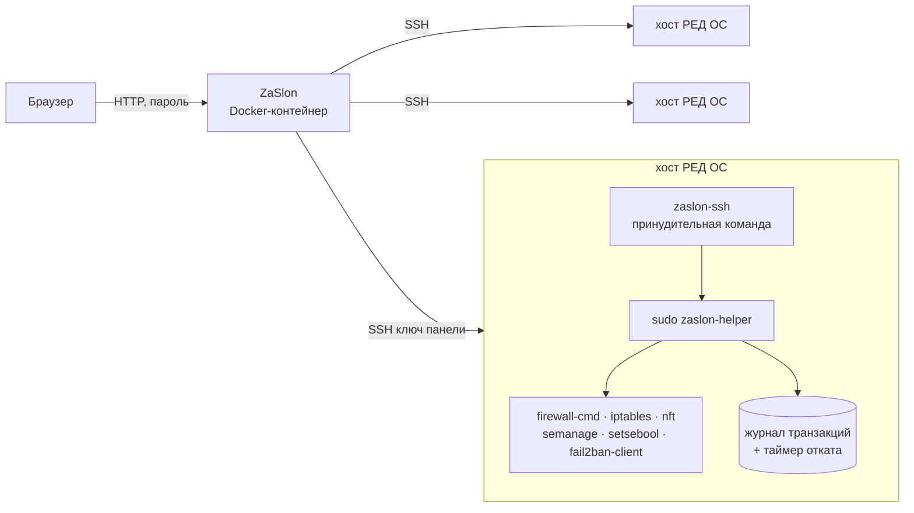

<p align="center">
  <picture>
    <source media="(prefers-color-scheme: dark)" srcset="docs/logo-dark.svg">
    
  </picture>
</p>

<p align="center">
  <b>Веб-панель для межсетевых экранов хостов РЕД ОС — в духе Cockpit, в одном Docker-контейнере.</b><br>
  firewalld, iptables и nftables, SELinux и fail2ban на всех хостах сразу: вкладка на каждый хост,<br>
  изменения с автоматическим откатом и отчёт по хосту в HTML и PDF.
</p>

<p align="center">
  
  
  
  
  
  
</p>

<p align="center">
  
</p>

---

## Зачем

В домашней или небольшой рабочей сети хостов обычно несколько, и на каждом межсетевой экран живёт своей жизнью: в зоне `public` копятся порты от давно удалённых служб, Docker публикует контейнеры в обход зон, где-то firewalld вообще выключен, а SELinux отключён «на время». Cockpit показывает один хост за раз и не отвечает на главный вопрос — *что на самом деле доступно из сети*.

ZaSlon собирает состояние всех хостов в одну панель, сопоставляет правила firewall с реально слушающими службами и позволяет безопасно менять конфигурацию: любое изменение откатывается само, если после него панель потеряла доступ к хосту.

## Возможности

| Раздел | Что умеет |
|---|---|
| **Обзор** | Карточки и сравнительная таблица хостов: firewalld, SELinux, fail2ban, открытые и «мёртвые» порты, Docker в обход зон, замечания по важности. |
| **Порты** | Для каждого порта — открыт ли он в зоне (портом, службой, диапазоном), какой процесс его слушает и не публикует ли его Docker. Закрыть или открыть — в одно нажатие. |
| **Зоны firewalld** | target, интерфейсы, источники, службы (с каталогом хоста), порты, протоколы, проброс портов, маскарадинг, блокировка ICMP, rich rules с конструктором, зона по умолчанию, LogDenied. Расхождения текущих и сохранённых правил — с кнопками «сохранить» и «убрать». |
| **iptables / nftables** | Таблицы и цепочки со счётчиками; цепочки Docker, libvirt, fail2ban помечены и защищены от правки. Прямые правила firewalld (direct). nftables — просмотр любой таблицы. |
| **SELinux** | Режим сейчас и после перезагрузки, переключатели с поиском, метки портов (`semanage port`), поиск типа по номеру порта, отказы AVC за день и неделю. |
| **fail2ban** | Jails, заблокированные адреса со снятием бана, исключения. |
| **Изменения** | Очередь изменений → одна транзакция на хосте → таймер отката → автоподтверждение новым SSH-соединением. Журнал транзакций на хосте и журнал действий панели. |
| **Отчёт** | Печатный отчёт по хосту: сводка, замечания, зоны, порты, iptables/nftables, SELinux, fail2ban, SSH, история изменений. HTML или PDF. |
| **Хосты** | Добавление, удаление, правка данных хоста (адрес, порт, пользователь, роль, расположение, метки), проверка подключения, сброс отпечатка SSH. |

## Скриншоты

<table>
  <tr>
    <td width="50%"><br><sub><b>Порты.</b> Raspberry Pi с Docker: часть портов открыта в зоне, но никто не слушает; контейнеры опубликованы в обход firewalld.</sub></td>
    <td width="50%"><br><sub><b>Зона public</b> файлового сервера: службы с портами из каталога, rich rule для PostgreSQL из локальной сети.</sub></td>
  </tr>
  <tr>
    <td><br><sub><b>Применение.</b> Изменения копятся в очереди и уходят одной транзакцией с таймером отката.</sub></td>
    <td><br><sub><b>SELinux</b>: режим, изменённые переключатели, локальные метки портов и свежие отказы AVC.</sub></td>
  </tr>
  <tr>
    <td><br><sub><b>Сводка по хосту</b> с замечаниями и проверкой, что панель сохраняет доступ по SSH.</sub></td>
    <td><br><sub><b>Отчёт</b> по хосту — HTML или PDF формата A4.</sub></td>
  </tr>
</table>

## Как это устроено



- **Без агентов.** На хостах нет постоянно работающих служб. Панель подключается по SSH под пользователем `sec_fw-admin` и запускает `zaslon-helper` — один Python-скрипт без зависимостей (на РЕД ОС 8 есть Python 3.11).
- **Транзакции.** Перед первым изменением helper сохраняет копию `/etc/firewalld` и ставит таймер `systemd-run` на откат. Каждое выполненное действие сразу записывается вместе с обратным. Если подтверждение не пришло вовремя или на середине произошла ошибка, хост сам выполняет обратные действия в обратном порядке.
- **Защита доступа.** После применения helper моделирует порядок правил firewalld (rich rules с приоритетами, службы, порты, проброс, target) для адреса панели — в текущей и в сохранённой конфигурации. Если SSH для панели закрылся бы, изменение не применяется. Панель подтверждает транзакцию *новым* SSH-соединением: не смогла подключиться — сработает откат.
- **Анализ на стороне панели.** Сопоставление «зона ↔ сокет ↔ DNAT Docker», расхождения runtime/permanent, замечания по SELinux, SSH и fail2ban считаются в контейнере из собранного состояния.

## Безопасность

- Ключ панели в `authorized_keys` ограничен: `command="…/zaslon-ssh"`, `restrict`, `from="адрес панели"`. Через него нельзя получить shell — только вызвать helper с известными подкомандами.
- Каталог `.ssh` пользователя `sec_fw-admin` принадлежит root, пароль пользователя заблокирован, `sudo` разрешён только на `zaslon-helper`.
- helper запускается с `python3 -I`, с чистым окружением, все команды — без shell, каждый аргумент проверяется (имена зон и служб, порты, адреса; в правилах iptables запрещены `-t`, `-M/--modprobe` и команды цепочек).
- Панель требует пароль (`ZASLON_PASSWORD`, генерируется при установке); без пароля отвечает только на запросы с самого хоста. Изменяющие запросы принимаются только из интерфейса панели (защита от CSRF).
- Адрес панели добавляется в исключения fail2ban, чтобы панель не забанила сама себя при опросе.

## Быстрый старт

Нужны: компьютер с macOS или Linux, откуда есть SSH на хосты под администратором с `sudo`; хост с Docker для панели (подойдёт Raspberry Pi 4/5).

```bash
git clone https://github.com/ArsIS-02/zaslon.git && cd zaslon

# 1. Диагностика: хосты из /etc/hosts, ответившие на ping; пользователь спрашивается перед каждым подключением.
#    Ничего не меняет, отчёты — в ~/ZaSlon/fw-diag/, список «хост → администратор» — в ~/ZaSlon/users.conf
bash scripts/zaslon-diag.sh

# 2. Подготовка хостов: пользователь sec_fw-admin, helper, ключ панели, исключение в fail2ban.
#    -z — адрес хоста, где будет работать панель
bash scripts/zaslon-provision.sh -z 10.0.0.5

# 3. Установка панели на этот хост: сборка образа, пароль входа, проверка ключа на всех хостах
bash scripts/zaslon-deploy.sh
```

Подробно каждый шаг — в [руководстве по установке](docs/install.md).

### Вход в панель

Панель открывается на `http://<хост панели>:8585`, браузер спросит логин и пароль.

- **Логин:** `admin`.
- **Пароль:** пароля по умолчанию **нет**. При первом запуске `zaslon-deploy.sh` генерирует случайный пароль (20 букв и цифр), показывает его один раз в конце вывода и сохраняет в `~/zaslon/.env` на хосте панели. Посмотреть позже:

  ```bash
  ssh <пользователь>@<хост панели> 'grep ZASLON_PASSWORD ~/zaslon/.env'
  ```
- **Сменить:** отредактируйте `ZASLON_PASSWORD=` в `~/zaslon/.env` и выполните `docker compose up -d` в `~/zaslon`. Повторные запуски `zaslon-deploy.sh` пароль не трогают.
- **Без пароля** панель доступна только с самого хоста (`127.0.0.1`), из сети она отвечает отказом.

### Готовый образ

Образы для `linux/amd64` и `linux/arm64` публикуются в GitHub Container Registry при каждом релизе — Docker сам скачает образ под архитектуру хоста. Хосты готовятся так же (шаги 1–2), а на хосте панели вместо сборки:

```bash
git clone https://github.com/ArsIS-02/zaslon.git ~/zaslon && cd ~/zaslon
mkdir -p data/keys && cp ~/ZaSlon/keys/zaslon_ed25519* data/keys/ && chmod 600 data/keys/zaslon_ed25519
printf 'ZASLON_UID=%s\nZASLON_GID=%s\nZASLON_PASSWORD=%s\n' "$(id -u)" "$(id -g)" "$(openssl rand -base64 18)" > .env
docker compose pull && docker compose up -d
```

Конкретная версия: `ZASLON_TAG=1.1.0` в `.env`. Для хостов без доступа к интернету к каждому [релизу](https://github.com/ArsIS-02/zaslon/releases) приложены архивы образов: `docker load -i zaslon-<версия>-linux-amd64.tar.gz`.

### Вручную через Docker (сборка из исходников)

```bash
mkdir -p data/keys && cp ~/ZaSlon/keys/zaslon_ed25519* data/keys/ && chmod 600 data/keys/zaslon_ed25519
printf 'ZASLON_UID=%s\nZASLON_GID=%s\nZASLON_PASSWORD=%s\n' "$(id -u)" "$(id -g)" "$(openssl rand -base64 18)" > .env
docker compose up -d --build
```

### Демо без хостов

```bash
docker compose run --rm -p 8585:8585 -e ZASLON_DEMO=1 -e ZASLON_PASSWORD=demo zaslon   # вход: admin / demo
# или без Docker:
pip install -r requirements.txt && ZASLON_DATA=/tmp/zaslon ZASLON_DEMO=1 uvicorn app.main:app --port 8585
```

Демо-сеть `10.42.0.0/24` вымышленная (`tools/make_demo.py`); изменения в демо-режиме имитируются в памяти.

## Документация

| | |
|---|---|
| [Установка](docs/install.md) | требования, три шага установки, **пароль входа**, ручная установка, переменные, обновление и удаление |
| [Работа с панелью](docs/usage.md) | вкладки и разделы, таблица портов, очередь изменений и откат, типовые задачи, данные панели |
| [Безопасность](docs/security.md) | вход, ключ панели и `sec_fw-admin`, ограничения helper, защита от потери доступа |
| [Устройство](docs/architecture.md) | компоненты, API панели, подкоманды и операции helper, формат транзакции |
| [Решение проблем](docs/troubleshooting.md) | ошибки панели, подключения к хостам, скриптов и изменений |

## Скрипты

| Скрипт | Где запускать | Что делает |
|---|---|---|
| `scripts/zaslon-diag.sh` | Mac / Linux | Обходит хосты из `/etc/hosts`, проверяет SSH и признаки бана, запускает диагностику (только чтение). |
| `scripts/diag-redos-fw.sh` | на хосте, через `zaslon-diag.sh` | Собирает firewalld, iptables, nftables, SELinux, открытые порты и настройки SSH в текстовый отчёт. |
| `scripts/zaslon-provision.sh` | Mac / Linux | Готовит хосты к управлению (`--remove` — убирает всё). Повторный запуск обновляет helper. |
| `scripts/zaslon-deploy.sh` | Mac / Linux | Ставит или обновляет панель на хосте с Docker. |
| `host/zaslon-hostsetup.sh` | на хосте, через `zaslon-provision.sh` | Пользователь, ключ, sudo, fail2ban. |

Рабочий каталог скриптов — `~/ZaSlon` (переопределяется `ZASLON_HOME`): `users.conf`, ключ панели `keys/`, журналы `logs/`, отчёты `fw-diag/`, настройки `zaslon.conf` (`PANEL_HOST`, `KNOWN_USERS`).

## Настройки панели (`.env`)

| Переменная | По умолчанию | |
|---|---|---|
| `ZASLON_PASSWORD` | — | пароль входа; без него панель доступна только с самого хоста |
| `ZASLON_LOGIN` | `admin` | логин |
| `ZASLON_PORT` / `ZASLON_BIND` | `8585` / `0.0.0.0` | порт и адрес публикации |
| `ZASLON_UID` / `ZASLON_GID` | `1000` | от чьего имени работает контейнер (владелец `./data`) |
| `ZASLON_WITH_PDF` | `1` | `0` — образ без Chromium; PDF тогда сохраняется печатью из браузера |
| `TZ` | `UTC` | часовой пояс в отчётах |

Остальное — пользователь SSH, таймер отката, автоподтверждение — меняется в настройках панели.

## Структура

```
app/        бэкенд: API (main.py), SSH-транспорт, анализ портов и замечаний, отчёты, демо-данные
static/     интерфейс: ES-модули без сборки, тёмная тема
host/       zaslon-helper, zaslon-ssh, zaslon-hostsetup.sh — то, что ставится на хосты
scripts/    диагностика, подготовка хостов, установка панели
tests/      тесты разбора и SSH-защиты; интеграционный тест транзакций; UI smoke-тест
tools/      генерация демо-данных и скриншотов
```

## Тесты

```bash
python3 tests/test_helper.py                       # разбор вывода firewall-cmd, ss, iptables-save, semanage; SSH-защита
docker run --rm -v "$PWD":/src -w /src python:3.12-slim \
  bash -c 'ZASLON_TEST_CONTAINER=1 bash tests/test_tx.sh'   # транзакции, откат, защита от инъекций
python3 tests/ui_smoke.py                          # интерфейс (Playwright, панель в демо-режиме)
```

## Ограничения

- Рассчитано на РЕД ОС 8 с firewalld на nftables и iptables-nft. Другие RHEL-подобные системы с firewalld, скорее всего, тоже подойдут, но не проверялись.
- Правила iptables, созданные Docker, libvirt и антивирусами, только показываются. Свои постоянные правила задаются через зоны, rich rules или прямые правила firewalld.
- Защита доступа моделирует зоны firewalld; политики между зонами и прямые правила не моделируются — от них страхует таймер отката.

Подробнее — в [docs/security.md](docs/security.md).

## Лицензия

[MIT](LICENSE). Шрифты Inter и DejaVu Sans Mono — под своими свободными лицензиями, см. [THIRD_PARTY.txt](THIRD_PARTY.txt).
