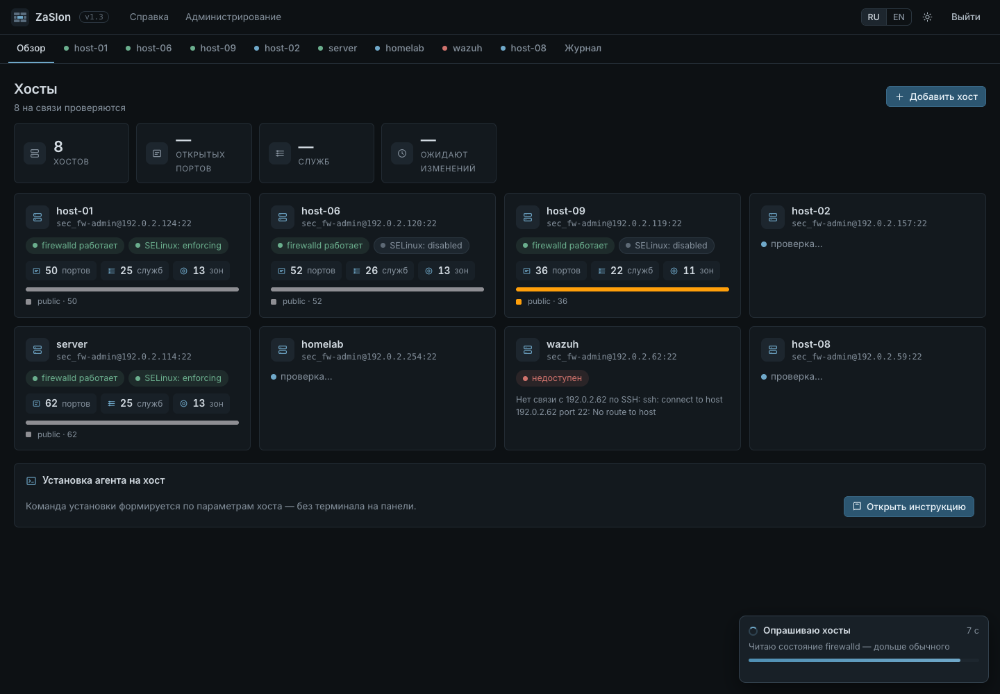
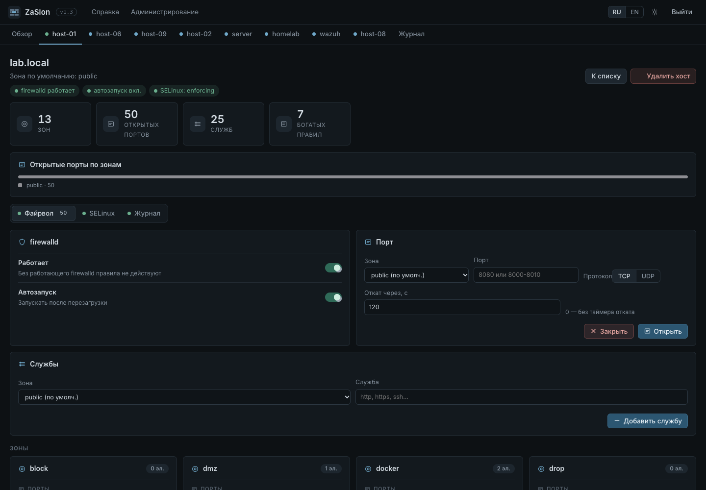
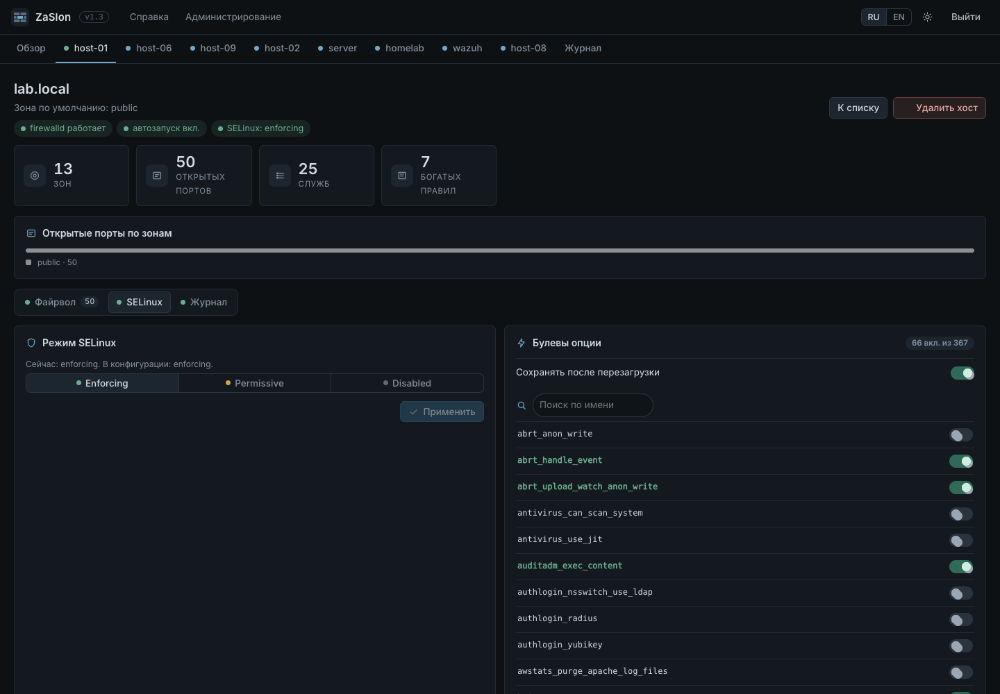
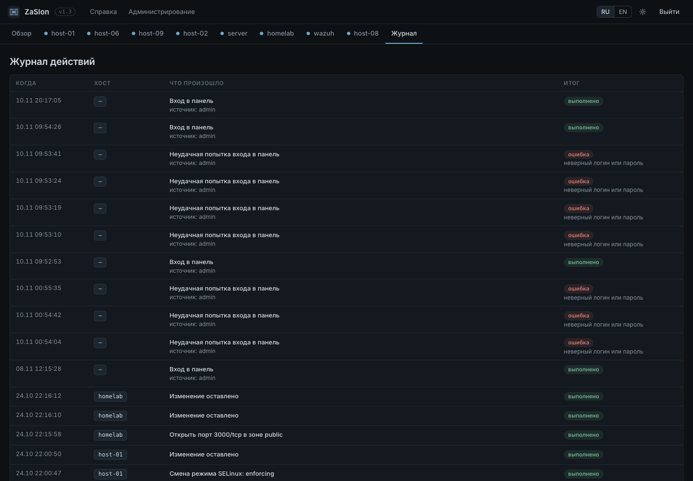
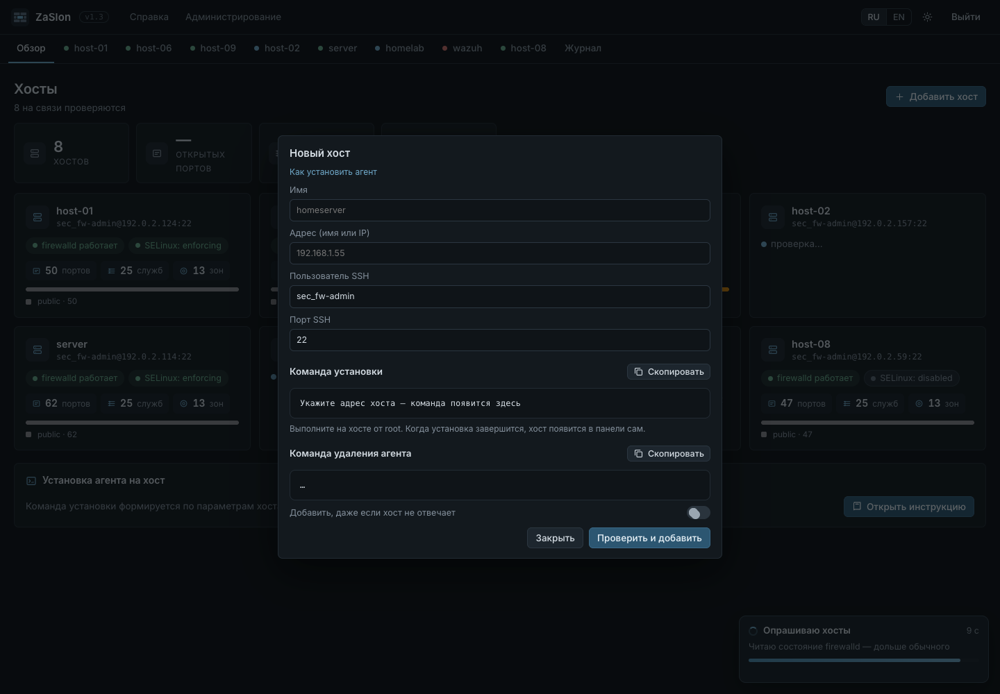
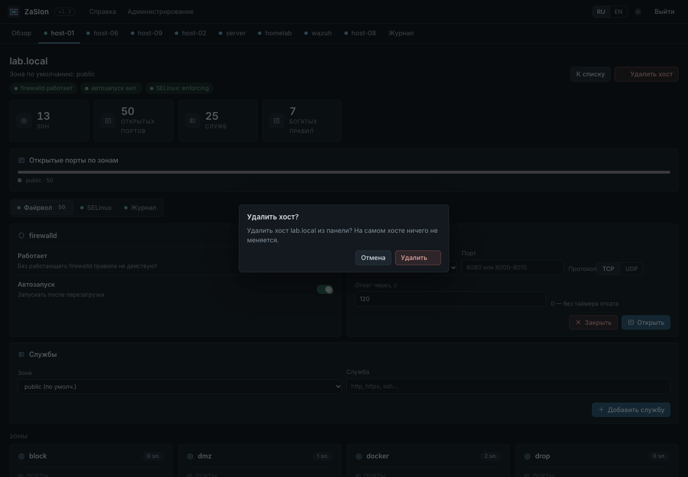
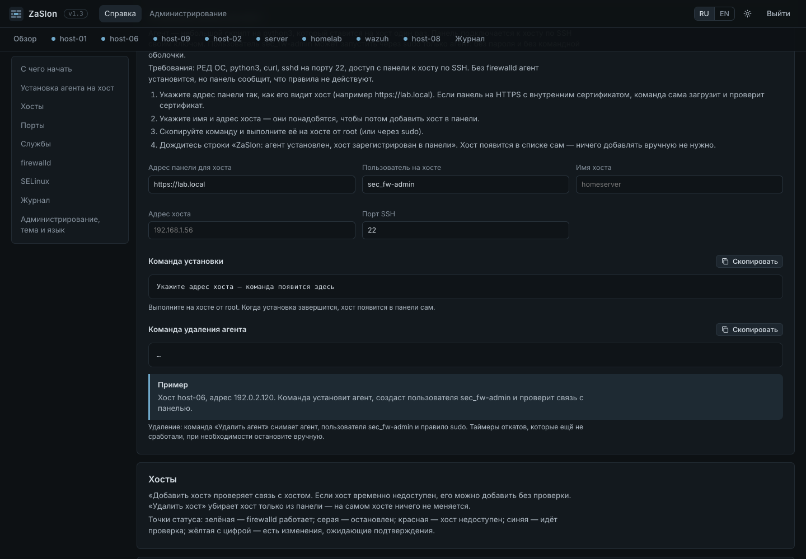
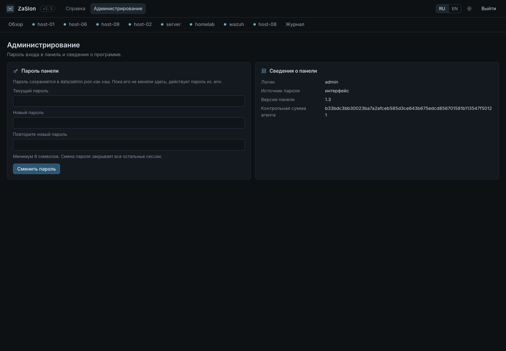

# ZaSlon

Веб-панель для управления **firewalld**, портами, службами и **SELinux** на хостах РЕД ОС — из браузера, без терминала на каждом хосте.

ZaSlon не заменяет firewalld и не держит собственных правил: панель отправляет команды на хосты через небольшой агент, а каждое изменение защищено таймером отката.

## Возможности

- Открыть и закрыть порт (TCP/UDP, диапазоны) и службу в зоне — постоянно или до перезагрузки.
- Включить, выключить firewalld и его автозапуск.
- Режим SELinux (enforcing / permissive / disabled) и булевы опции.
- **Откат по таймеру.** Любое изменение откатывается само, если его не подтвердить (по умолчанию 120 с). Так не теряется доступ по SSH.
- Журнал действий панели на понятном языке.
- Установка агента на хост одной командой: команда формируется в форме «Новый хост», хост регистрируется в панели сам.
- Интерфейс на русском и английском, светлая и тёмная темы.
- Раздел «Справка» с инструкциями и примерами.

## Скриншоты

| | |
|---|---|
|  |  |
| Обзор: состояние каждого хоста, открытые порты, ожидающие подтверждения изменения | Страница хоста: firewalld, порты по зонам, службы, зоны |
|  |  |
| SELinux: режим и булевы опции с переключателями | Журнал действий панели на понятном языке |
|  |  |
| Новый хост: команда установки формируется по полям | Подтверждение действия в стиле панели |
|  |  |
| Справка с инструкцией по установке агента | Администрирование: смена пароля панели |

Светлая тема и английский интерфейс: [hosts-light.png](docs/screenshots/hosts-light.png), [hosts-en.png](docs/screenshots/hosts-en.png). Страница входа: [login.png](docs/screenshots/login.png).

## Как устроено

    браузер ──HTTPS──▶ панель (контейнер) ──SSH, ключ панели──▶ хост РЕД ОС
                                                     └─ sudo ──▶ агент (Python, stdlib)

- На хосте работает пользователь `sec_fw-admin` без пароля: вход только по ключу панели, и ключ ограничен одной командой — запуском агента. Командной оболочки нет.
- `sudo` разрешает этому пользователю ровно один файл — агент.
- Агент читает состояние и меняет настройки через firewalld и SELinux; состояние изменений хранится в `/var/lib/zaslon/tx`.

## Быстрый старт: панель

Нужны podman или docker и доступ к хостам по SSH.

1. Создайте файл `.env` рядом с docker-compose.yml:

        ZASLON_LOGIN=admin
        ZASLON_PASSWORD=придумайте-длинный-пароль

2. Запустите:

        docker compose up -d --build

   Данные (ключ панели, список хостов, журнал, пароль из интерфейса) лежат в `./data`. Папку не публикуйте.

3. Откройте панель на порту 8585 и войдите.

4. Смена пароля — раздел «Администрирование». Новый пароль сохраняется в `data/admin.json` (PBKDF2-SHA256, открытым на диск не пишется). После смены пароль из `.env` перестаёт действовать; смена также завершает все активные сессии.

### HTTPS

Панель отдаёт обычный HTTP. Для HTTPS поставьте перед ней обратный прокси (например Caddy). Если прокси выдаёт сертификат из собственного CA, см. раздел «Добавление хоста».

## Добавление хоста

1. Во вкладке «Хосты» нажмите «Добавить хост» и введите имя и адрес.
2. Скопируйте команду установки, которая появится в диалоге, и выполните её на хосте от root.
3. Когда установка завершится, хост появится в панели сам. Панель проверит SSH-связь и зарегистрирует хост по одноразовому токену.

Команда делает следующее:

- скачивает `zaslon-install.sh` и сверяет его контрольную сумму;
- если панель на HTTPS с внутренним сертификатом, загружает корневой сертификат, сверяет отпечаток с отпечатком из команды и ставит его в доверенные (старый сертификат ZaSlon заменяется);
- скачивает агент, проверяет его контрольную сумму и устанавливает;
- регистрирует хост в панели.

Для внутреннего CA Caddy положите корневой сертификат один раз:

    mkdir -p data/ca
    podman exec caddy cat /data/caddy/pki/authorities/local/root.crt > data/ca/root.crt

Без этого файла команда не проверит HTTPS-панель на хосте, которому не доверяет CA.

Удаление агента: команда «Команда удаления агента» в том же диалоге. Она убирает агент, пользователя `sec_fw-admin` и правило sudo.

Ручная установка без формы (если нужна): на хосте `sudo bash host/setup-host.sh "<ключ панели>"`, затем «Добавить хост» в панели.

## Журнал в Graylog

Журнал действий можно отправлять в Graylog по GELF: там он хранится вместе с остальными логами, а по неудачным входам и изменениям защиты строятся алерты. В `.env`:

    ZASLON_GELF_HOST=192.0.2.10     # адрес входа GELF в Graylog
    ZASLON_GELF_PORT=12201
    ZASLON_GELF_PROTO=udp           # или tcp

После перезапуска проверка — «Администрирование» → «Журнал в Graylog» → «Отправить тестовое сообщение»; в Graylog оно находится запросом `zs_op:test`.

Каждая запись журнала — отдельное сообщение. Поля:

| Поле | Что в нём |
|---|---|
| `zs_source`, `homelab_app` | всегда `zaslon` — по ним настраивается поток |
| `zs_op` | операция: `port_change`, `service_change`, `firewalld_set`, `selinux_mode`, `selinux_bool`, `tx_confirm`, `tx_rollback`, `host_add`, `host_enroll`, `host_remove`, `admin_password`, `login`, `login_failed` |
| `zs_host`, `zs_host_address` | имя и адрес хоста, на котором что-то меняли |
| `zs_arg_*` | аргументы операции: `zs_arg_zone`, `zs_arg_port`, `zs_arg_proto`, `zs_arg_add`, `zs_arg_mode`, `zs_arg_name`, `zs_arg_value`, `zs_arg_timeout` … |
| `zs_ok`, `zs_error` | результат и текст ошибки |
| `zs_tx` | транзакция с таймером отката |
| `zs_who`, `zs_login`, `zs_client_ip` | кто: панель, хост при регистрации, администратор; логин и адрес при входе |

Уровень `level` 4 (warning) — у неудачных операций, неудачного входа, смены пароля, добавления и удаления хостов, отката, перевода SELinux в permissive или disabled и остановки firewalld. Остальные изменения — 5, входы — 6.

Зачем это нужно в SIEM: агент ZaSlon меняет режим SELinux через `setenforce`, и правило вида «кто-то выполнил setenforce 0» в Graylog сработает на действие из панели так же, как на атаку. Событие ZaSlon с именем хоста и временем позволяет отличить одно от другого. Готовые потоки, алерты и правило pipeline — в [Graylog_streams-alerts](https://github.com/ArsIS-02/Graylog_streams-alerts), глава 21.

## Безопасность

- Вход через форму, cookie-сессия с подписью HMAC и сроком 12 часов. Сессии отзываются на сервере при выходе.
- Пароль панели хранится хэшем. Смена пароля завершает все сессии.
- Все изменяющие запросы требуют заголовок `X-Zaslon` (защита от CSRF).
- Токены регистрации хостов одноразовые, живут час. В файле хранится только их SHA-256.
- Агент принимает команды только от панели через принудительную команду в `authorized_keys` и через sudo без пароля для одного файла.
- Журнал действий фиксирует все изменения: кто, что и с каким результатом.

Известные ограничения: нет ограничения частоты входа и запросов (неудачные входы пишутся в журнал и могут уходить в Graylog для алерта), одна учётная запись администратора, нет двухфакторной аутентификации. Для доступа из интернета ставьте панель за прокси с доступом по VPN или по списку адресов.

## Структура

- `host/zaslon-agent` — агент на хосте (Python, только стандартная библиотека).
- `host/setup-host.sh` — установка агента и пользователя (от root).
- `host/zaslon-install.sh` — установка одной командой, раздаётся панелью.
- `panel/` — веб-панель (Starlette): API, вход, регистрация хостов, связь с агентами по SSH.
- `static/` — интерфейс без сборки: HTML, JavaScript, CSS.

## Разработка и тесты

Тесты запускаются локально, без firewalld: системные команды заменяются заглушками из `tests/shims`.

    python3 tests/test_agent.py       # агент
    python3 tests/test_panel_e2e.py   # панель и агент вместе
    python3 tests/test_enroll.py      # регистрация хостов, CA, выход из системы
    python3 tests/test_gelf.py        # отправка журнала в Graylog

Для работы нужны Python 3 и Starlette (`requirements.txt`).

## Лицензия

GPL-3.0 — см. файл [LICENSE](LICENSE). Сторонние компоненты перечислены в [THIRD_PARTY.txt](THIRD_PARTY.txt).

## Вклад

Pull request'ы приветствуются. Если нашли баг или есть идея — открывайте issue.
